

# Wellnest Patient Portal

A frontend-only patient portal demo for reviewing upcoming care, managing appointments, and browsing a fictional health record.

**Live demo:** [a2rp.github.io/patient-portal](https://a2rp.github.io/patient-portal/)

## What the demo includes

- **Home** (`/home`): upcoming visit details, a care checklist, a health summary, and a list of upcoming appointments.
- **Appointments** (`/appointments`): search and filter visits, sort by date, open visit details, book a visit, reschedule, and cancel with a confirmation dialog.
- **Health records** (`/health-records`): search records, filter by category, open record details, and mark a record reviewed.
- **Notifications and help:** view appointment reminders or read how this demonstration works in custom dialogs.
- Responsive sidebar navigation, route scroll reset, and toast feedback for changes.

All names and health information are fictional. Changes stay in React state during the current visit and reset on refresh. The app has no backend, persistent browser storage, real health records, or connection to a clinic; do not enter personal medical information.

## Run locally

```bash
npm install
npm run dev
```

Run checks and deploy to GitHub Pages with:

```bash
npm run lint
npm run build
npm run deploy
```

The deploy script builds the Vite app, copies `dist/index.html` to `dist/404.html` for GitHub Pages route fallback, then publishes the `dist` folder to the `gh-pages` branch.

## Screenshots

The captures below show the current production build at desktop and mobile sizes, with the main routes and custom dialogs.

### Pages

| Page | Screenshot |
| --- | --- |
| Home dashboard | 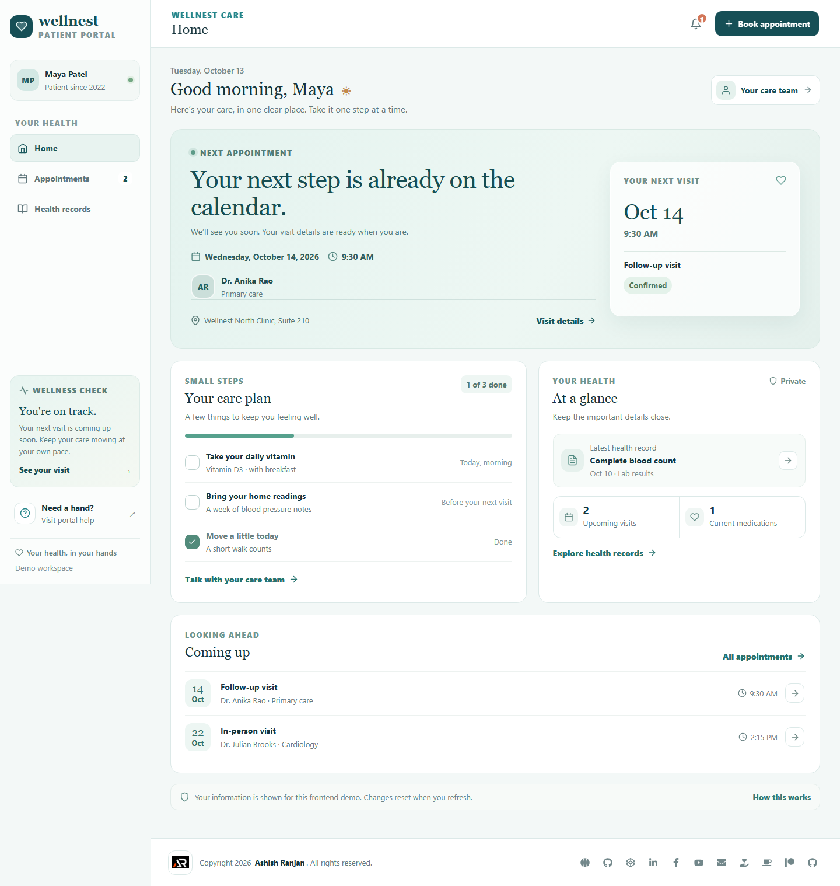 |
| Appointments | 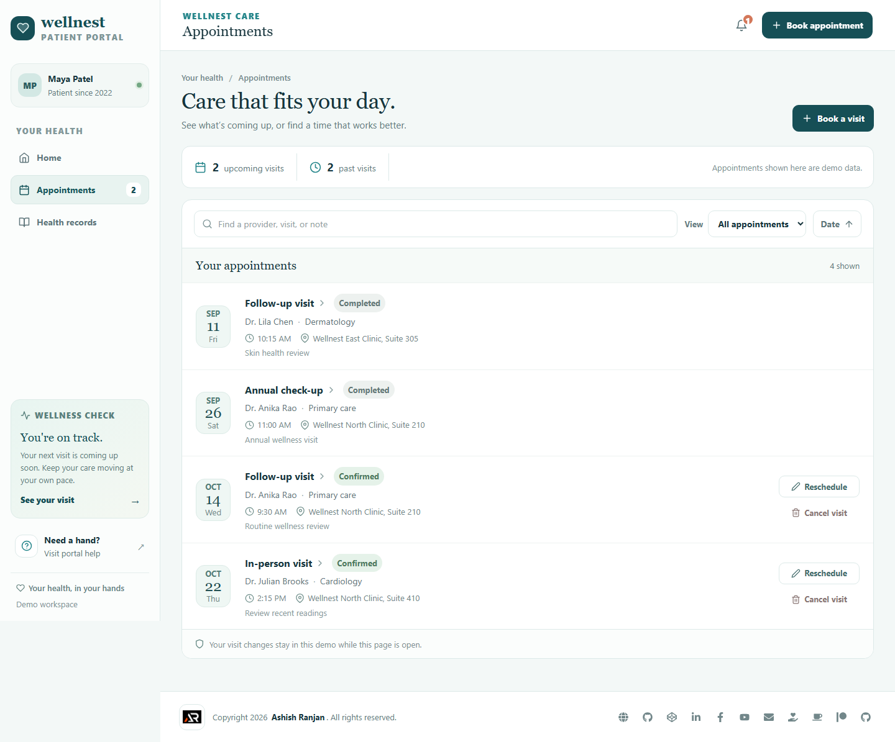 |
| Health records | 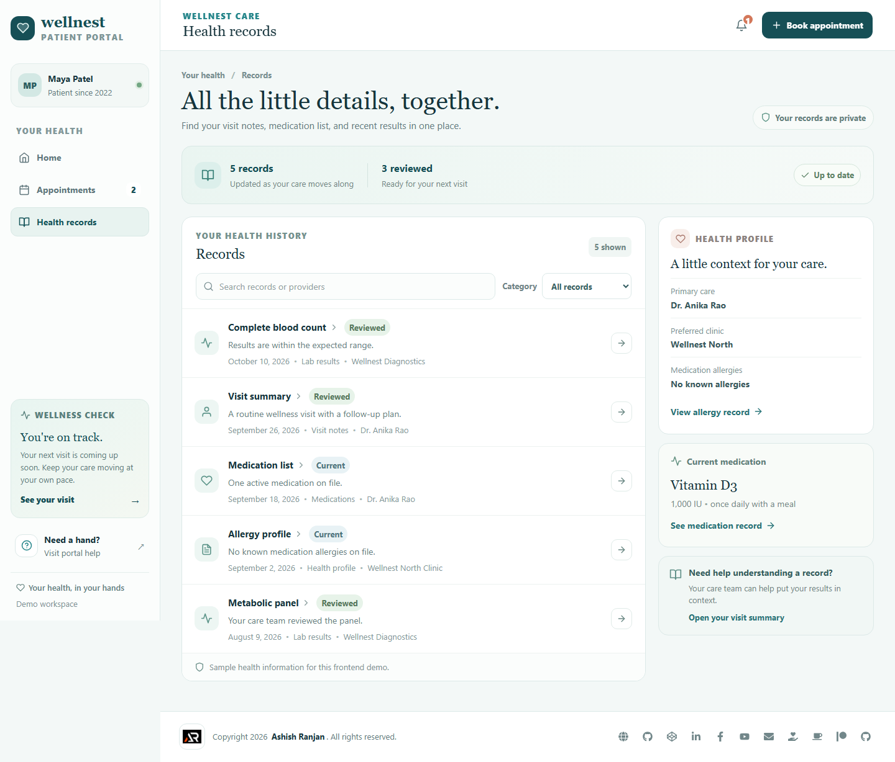 |
| Not found | 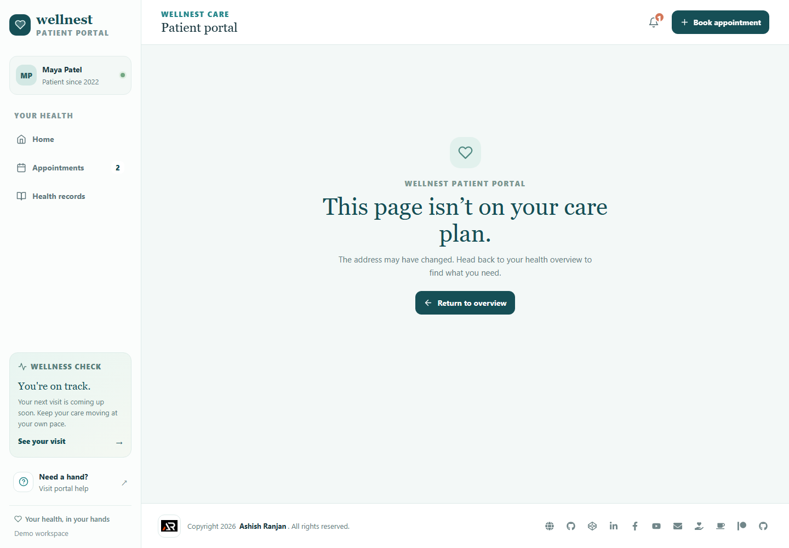 |
| Mobile home | 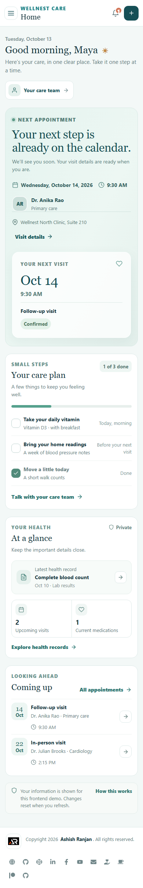 |
| Mobile navigation | 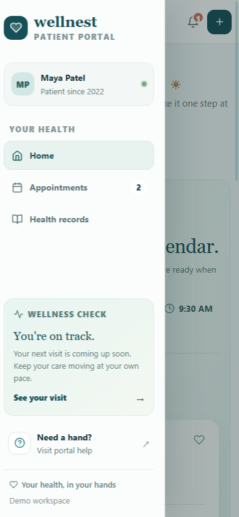 |

### Dialogs

| Dialog | Screenshot |
| --- | --- |
| Book appointment | 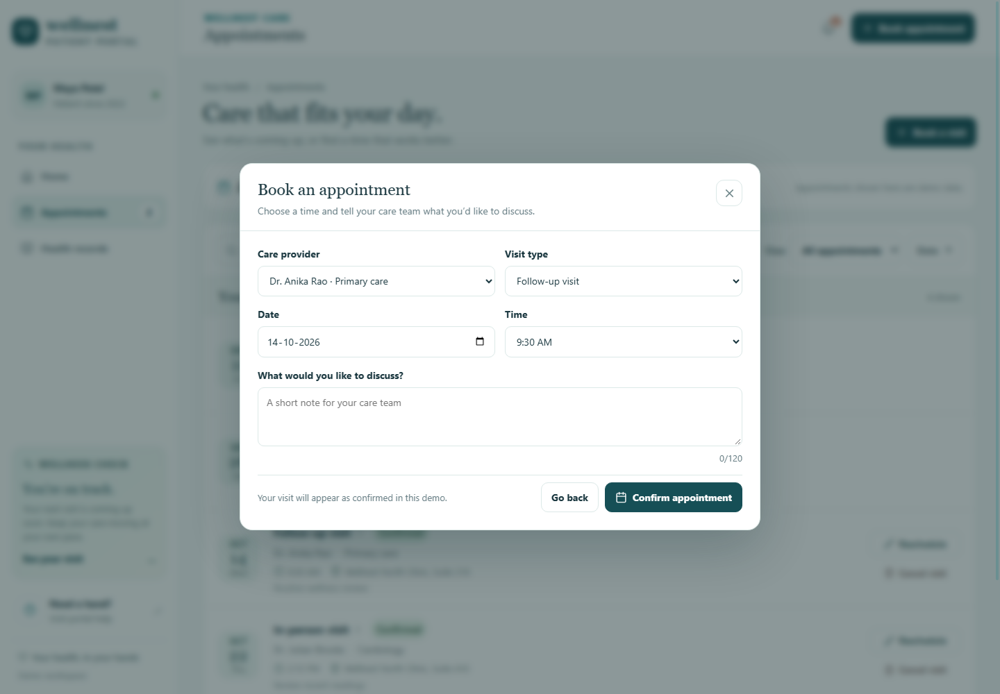 |
| Appointment validation | 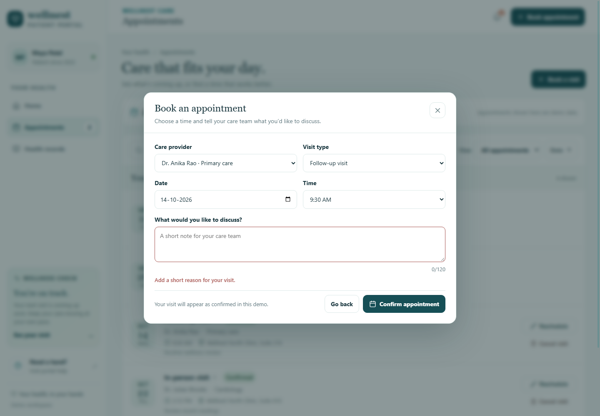 |
| Appointment details | 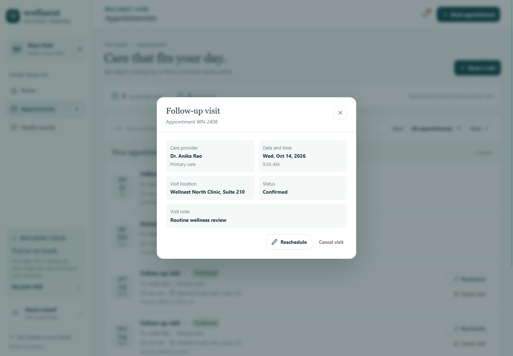 |
| Reschedule appointment | 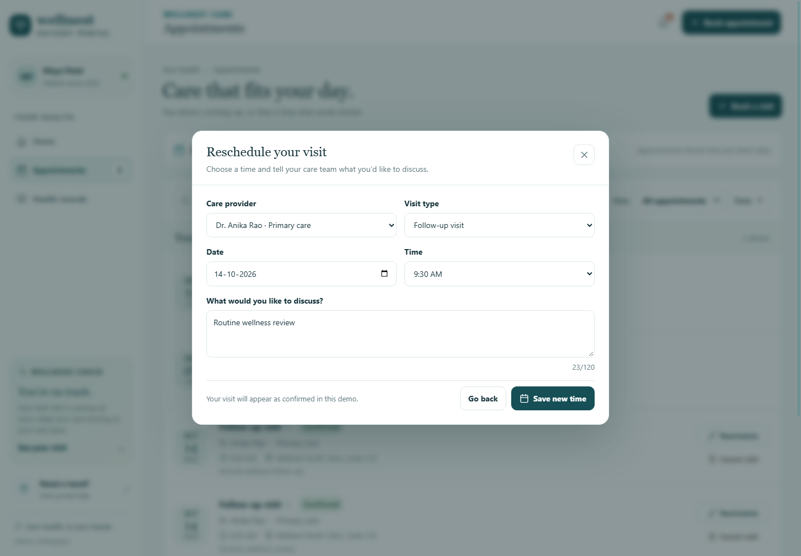 |
| Cancel appointment confirmation | 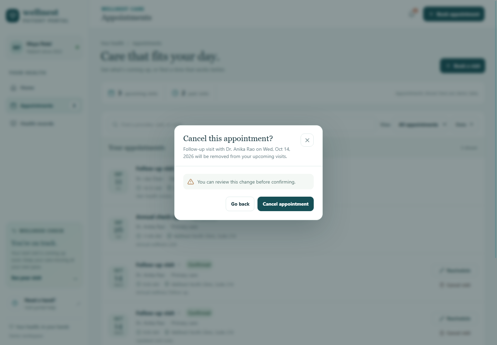 |
| Health record details | 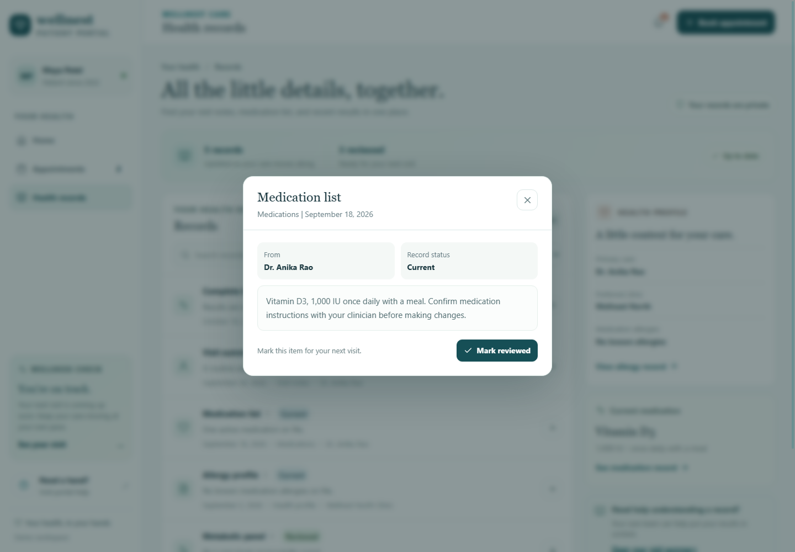 |
| Care reminders | 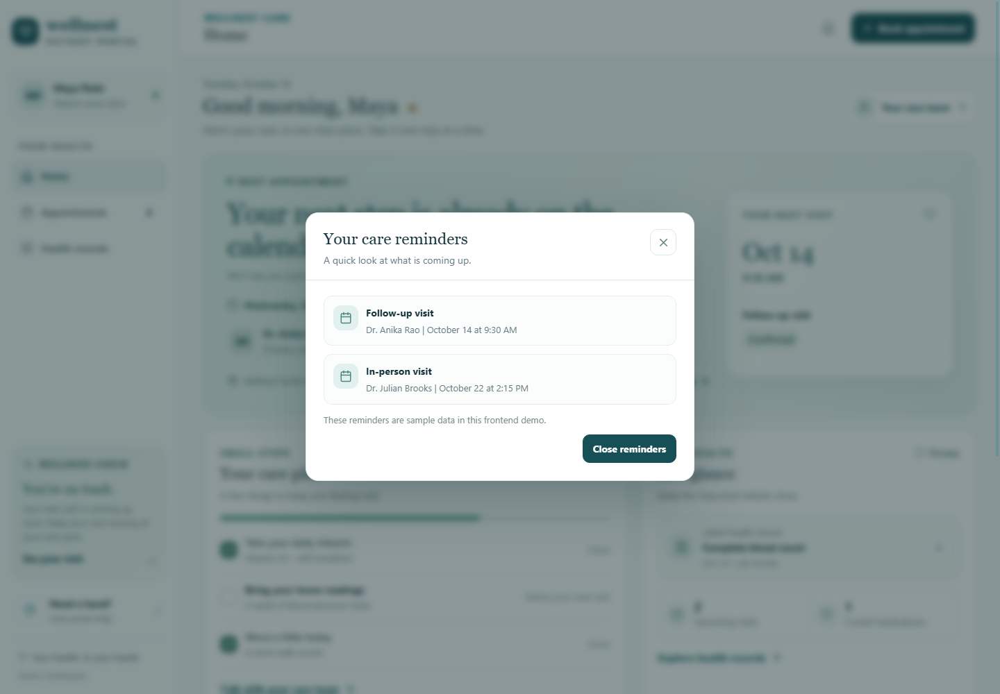 |
| Portal help | 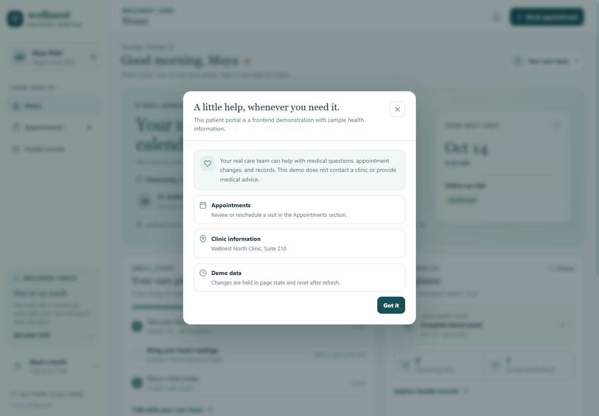 |

## Future improvements

- Connect appointment and patient data to a secure healthcare API with verified identity, consent, and access controls.
- Add provider scheduling, real appointment reminders, and secure telehealth integrations.
- Support secure document delivery and server-side audit history through an appropriate care system.

## Links

- Portfolio: [https://www.ashishranjan.net](https://www.ashishranjan.net)
- GitHub: [https://github.com/a2rp](https://github.com/a2rp)
- CodePen: [https://codepen.io/ash1198](https://codepen.io/ash1198)
- LinkedIn: [https://www.linkedin.com/in/aashishranjan](https://www.linkedin.com/in/aashishranjan)
- Facebook: [https://www.facebook.com/theash.ashish/](https://www.facebook.com/theash.ashish/)
- YouTube: [https://www.youtube.com/@ashishranjan-ashz?sub_confirmation=1](https://www.youtube.com/@ashishranjan-ashz?sub_confirmation=1)
- Email: [mailto:ash.ranjan09@gmail.com](mailto:ash.ranjan09@gmail.com)

## Support

- Support: [https://a2rp-donation-page.netlify.app/](https://a2rp-donation-page.netlify.app/)
- Buy Me a Coffee: [https://buymeacoffee.com/ashishranjan](https://buymeacoffee.com/ashishranjan)
- Patreon: [https://www.patreon.com/ashishranjan](https://www.patreon.com/ashishranjan)
