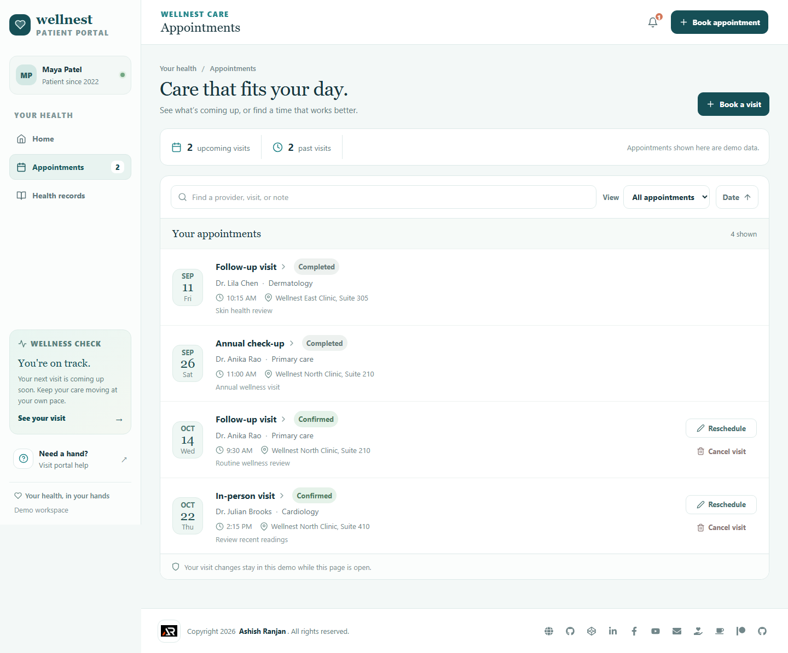
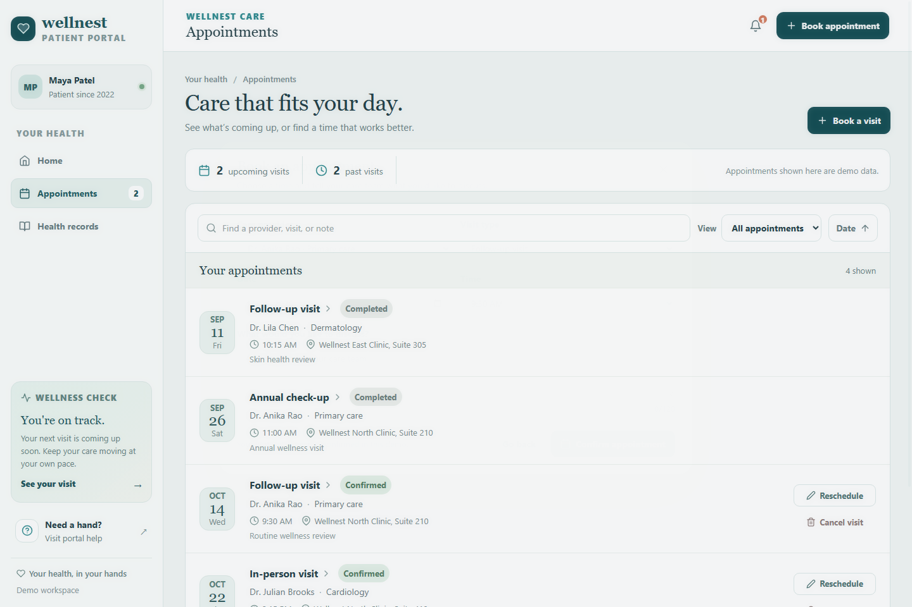
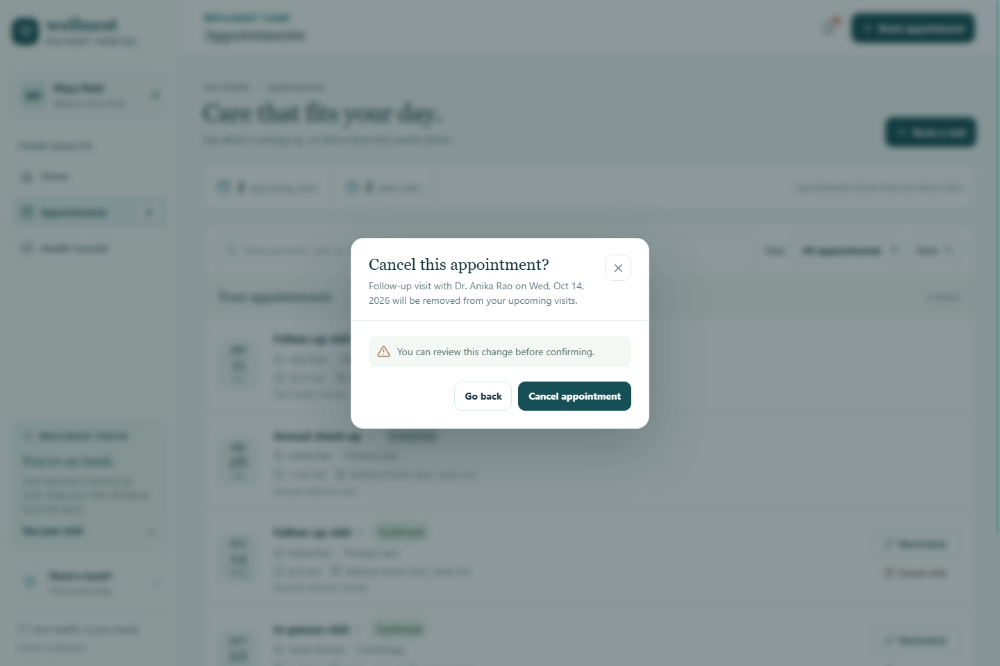
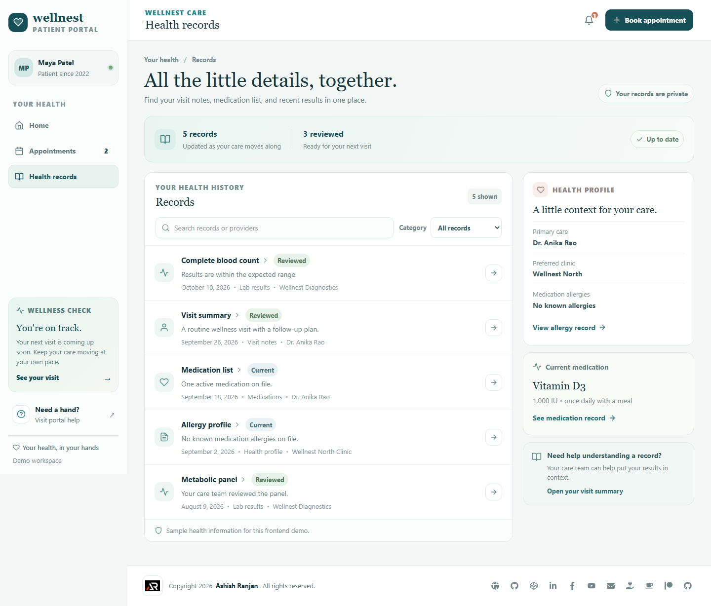
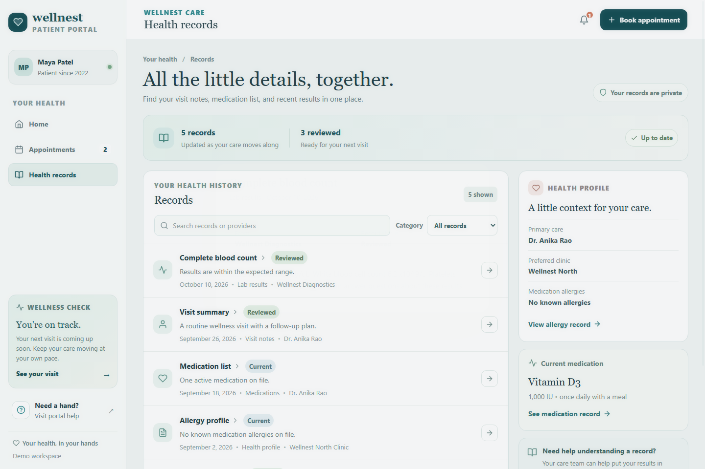
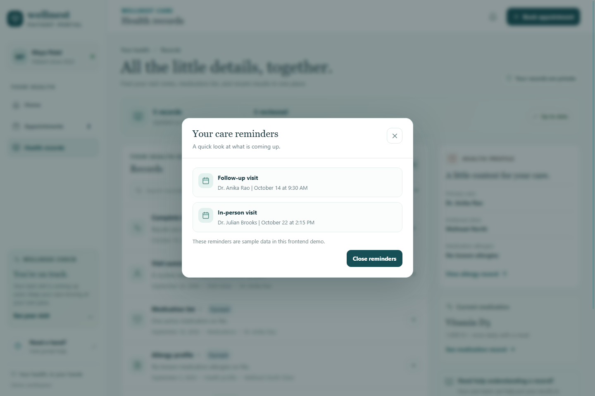
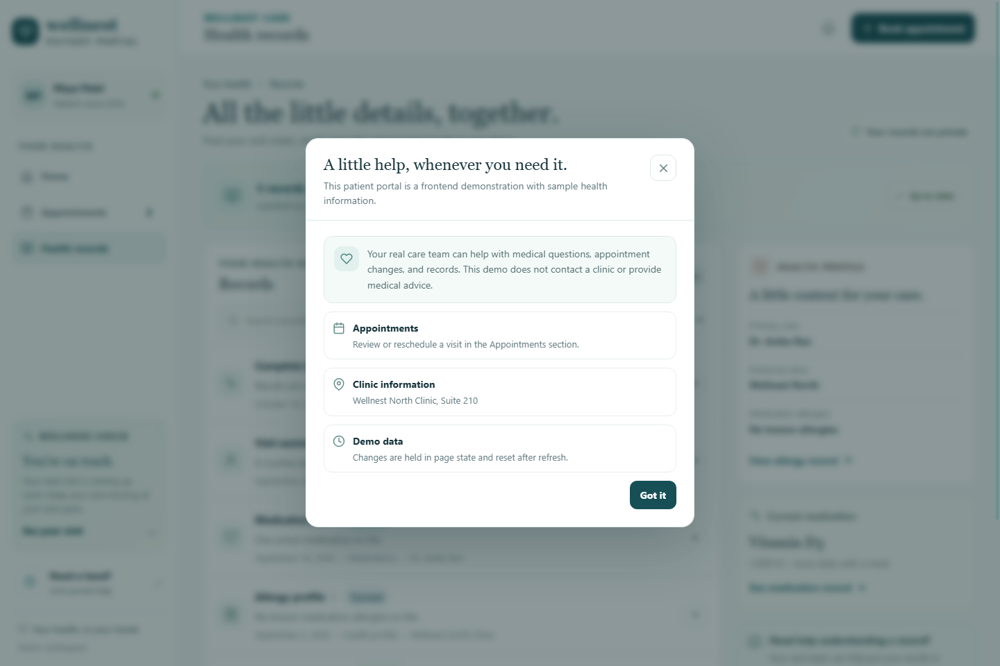
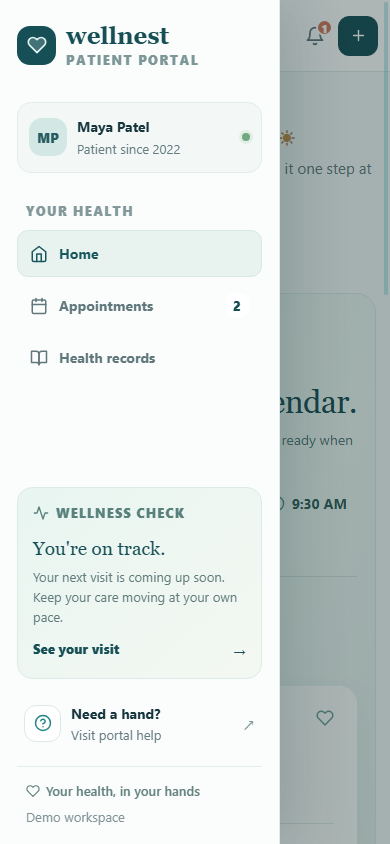
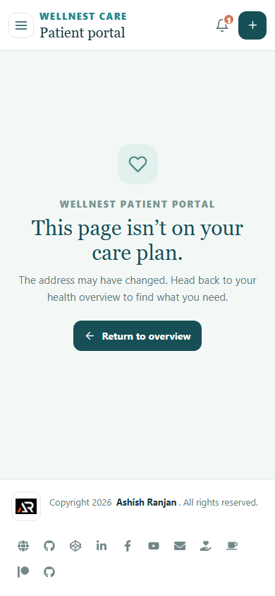

# Wellnest Patient Portal

A patient-facing healthcare portal concept for reviewing appointments, care plan reminders, and health records. This is a frontend-only demonstration using fictional patient and clinical data. It is not connected to a backend or a real health system.

## Live demo

[Open the Wellnest Patient Portal](https://a2rp.github.io/patient-portal/)

## Screenshots

### Home


### Appointments








### Health records





### Notifications and help





### Responsive layout




### Not found



## Features

- Home dashboard with upcoming visits, health summary, and an interactive care checklist.
- Appointment search, filters, date sorting, booking, rescheduling, details, and custom cancellation confirmation.
- Health record search and category filters, record details, and review status updates.
- Notification and help dialogs with clear demo-data messaging.
- Responsive sidebar navigation and route scroll reset.
- Toast feedback for changes, custom dialogs, and accessible keyboard dismissal.
- All page data uses React state and resets on refresh. The app does not use local storage or a backend.

## Run locally

```bash
npm install
npm run dev
```

Run the project checks and production build with:

```bash
npm run lint
npm run build
```

## Future backend integrations

- Connect patient identity, appointments, care plans, and clinical records to authenticated healthcare APIs.
- Add permission-aware access, consent controls, secure document storage, and audit history.
- Provide appointment reminders, provider scheduling, and secure telehealth links.
- Connect health record updates to a verified care team workflow.

All patient names and clinical information shown here are fictional sample data.
